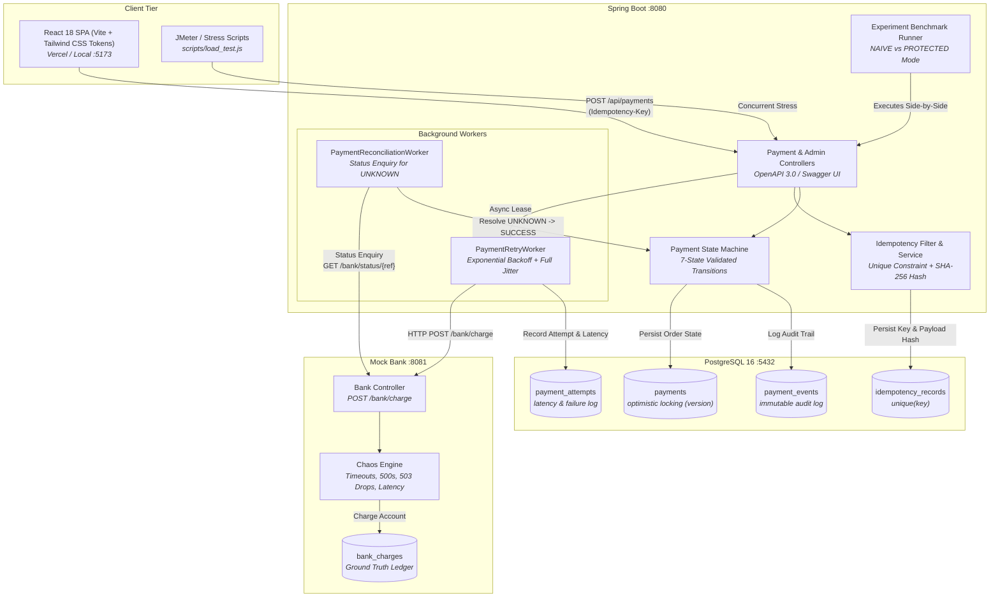
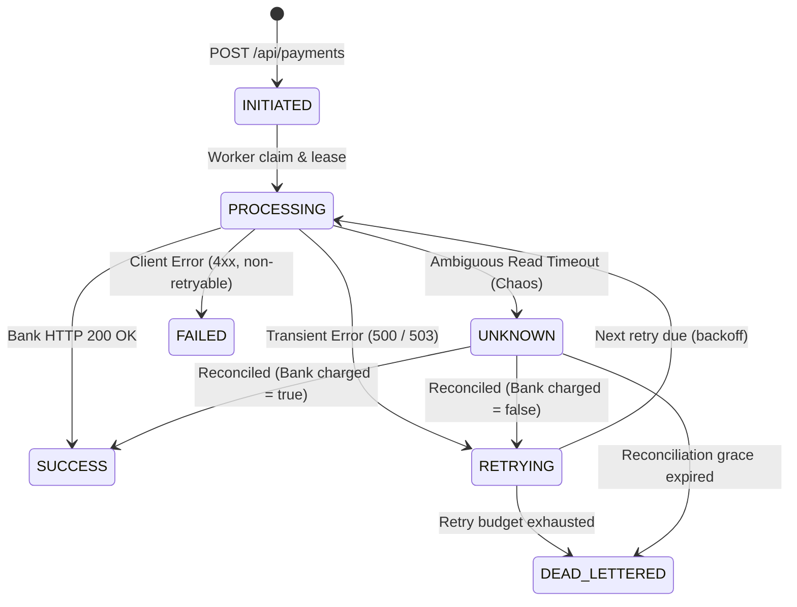

# ReliablePay — Fault-Tolerant Payment Processing Engine

> **Academic Design Project (Alliance University)** — Industry Brief partnered with **Citi**.  
> **Core Thesis**: Eliminating the distributed systems "charged-but-response-lost" timeout dilemma to achieve **0 duplicate charges** under severe banking channel failure and network chaos.

[](https://www.oracle.com/java/)
[](https://spring.io/projects/spring-boot)
[](https://www.postgresql.org/)
[](https://vitejs.dev/)
[](https://www.docker.com/)
[-success.svg)](backend)

---

## 1. System Architecture

ReliablePay decouples payment ingestion from bank settlement using a non-blocking asynchronous architecture, backed by PostgreSQL ACID transactions, strict idempotency enforcement, and scheduled background reliability workers.



---

## 2. 7-State Payment State Machine

The Citi brief outlines three broad business outcomes: **Pending**, **Success**, and **Failed**. ReliablePay implements this through a 7-state deterministic state machine preventing invalid lifecycle jumps:



### State Mapping to Citi Project Brief
| Citi Brief State | ReliablePay State | Description & Lifecycle Role |
|:---|:---|:---|
| **Pending** | `INITIATED` | Initial payment request validated and persisted; idempotency key leased. |
| **Pending** | `PROCESSING` | Worker has leased payment; dispatching HTTP charge to core bank switch. |
| **Pending** | `RETRYING` | Recoverable failure encountered; scheduled for exponential backoff retry. |
| **Pending** | `UNKNOWN` | Ambiguous timeout: request reached bank but response was lost in transit. Held in grace period pending status inquiry. |
| **Success** | `SUCCESS` | Terminal state: bank ledger debited exactly once. Immutable confirmation. |
| **Failed** | `FAILED` | Terminal state: client error (e.g. invalid account, HTTP 400). Non-retryable. |
| **Failed** | `DEAD_LETTERED` | Terminal state: retry budget exhausted without recovery. Flagged for manual review. |

---

## 3. Core Objectives & Verification Matrix

| Objective | Architectural Mechanism | Verification Test | Empirical Evidence Shown |
|:---|:---|:---|:---|
| **O1: Idempotency & Zero Double-Debits** | `IdempotencyService` enforces unique DB constraint on `Idempotency-Key` + SHA-256 payload hash. First call returns `201 Created`; replay returns `200 OK` with identical payload; modified replay returns `422 Unprocessable`. | `PaymentControllerIntegrationTest.java`<br/>`scripts/verify_acceptance.js` (Test 1) | Concurrent double-submit returns identical payment UUID (`2d6a4171-...`); exactly 1 bank debit recorded. |
| **O2: State Tracking & Automated Recovery** | 7-state machine (`PaymentStateMachine`), optimistic locking (`version` column), immutable `payment_events`, and background reconciliation worker querying `GET /bank/status/{ref}`. | `PaymentReconciliationTest.java`<br/>`PaymentStateMachineTest.java` | 100% of ambiguous `UNKNOWN` timeouts recovered automatically without double-debiting. |
| **O3: Empirical Evaluation under Chaos** | Side-by-side benchmark runner executing identical workloads through **NAIVE** (blind retries) and **PROTECTED** (7-state + reconciliation) protocols. | `ExperimentService.java`<br/>`scripts/prepare_demo.js`<br/>`scripts/parameter_sweep.js` | Under 30% timeout rate: **NAIVE produces 21–35 duplicate orders debited (₹2,600+ loss)**, while **PROTECTED produces exactly 0 duplicate orders**. |

---

## 4. Empirical Evaluation Results

ReliablePay was evaluated under systematic parameter sweeps and automated chaos benchmarks.

### Live Demo Benchmark Run (60 Orders, Concurrency 10, Timeout Rate 30%, Error Rate 10%)
```
======================================================================
BENCHMARK EVALUATION RESULTS
======================================================================
Experiment ID:              2c893ae2-3a68-4358-81dc-a9d84ccc0904
Workload:                   60 Orders per protocol (120 total)
Chaos Fault Rates:          30% Read Timeouts, 10% Server Errors, 500ms Latency
----------------------------------------------------------------------
Metric                      NAIVE Mode             PROTECTED Mode
----------------------------------------------------------------------
Total Orders Dispatched     60                     60
Duplicate Orders Charged    21 (35.0%)             0 (0.0%) [100% ELIMINATED]
Customer Overcharged Amount ₹2,600.00              ₹0.00
Successful Orders Succeeded 59                     60 (100%)
Dead Lettered Orders        1                      0
Retry Success Rate          96%                    100%
Prevented Financial Loss    ₹2,600.00
Direct Comparison UI        http://localhost:5173/compare/2c893ae2-3a68-4358-81dc-a9d84ccc0904
======================================================================
```

### High-Throughput Stress Test (scripts/load_test.js)
- **Total Requests**: 2,740 transactions
- **Throughput**: 102.10 requests/second sustained
- **Deadlocks / Integrity Violations**: 0
- **Average Latency**: 667 ms
- **P95 Latency**: 2,054 ms

---

## 5. Quick Start & Local Run Guide

### Prerequisites
- [Docker](https://docs.docker.com/get-docker/) & Docker Compose
- [Node.js](https://nodejs.org/) v18+ (tested on Node v20/v24)
- Java 17+ & Maven (optional, needed only for host-level builds)

### Step 1: Start Backend Services with Docker Compose
```bash
# Clone the repository
git clone https://github.com/nehaa-0420/Reliablepay.git
cd Reliablepay

# Start PostgreSQL, Redis, Mock Bank, and Payment Service
docker compose up --build -d
```

Verify service health:
- Payment Service: `http://localhost:8080/actuator/health` -> `{"status":"UP"}`
- Mock Bank: `http://localhost:8081/actuator/health` -> `{"status":"UP"}`
- Swagger UI Documentation: `http://localhost:8080/swagger-ui/index.html`

### Step 2: Start Frontend Application
```bash
cd frontend
npm install
npm run dev
```
Open your browser to `http://localhost:5173`.

### Step 3: Run 1-Command Automated Demo Prep
To prime the database, apply demo chaos, and generate a live benchmark comparison for your review:
```bash
# In the project root:
node scripts/prepare_demo.js
```

### Step 4: Run Acceptance Test Suite
```bash
# Validates health checks, concurrent double-submit idempotency, and side-by-side data
node scripts/verify_acceptance.js
```

---

## 6. Project Structure

```
payment-reliability-system/
├── backend/
│   ├── payment-service/          # Spring Boot Payment Engine
│   │   ├── src/main/java/...     # Controllers, Services, Workers, DTOs, Models
│   │   ├── src/main/resources/   # application.yml, db/migration (Flyway V1 SQL)
│   │   ├── src/test/java/...     # 35 Unit & Integration tests
│   │   └── Dockerfile
│   └── mock-bank/                # Simulated Core Banking Switch
│       ├── src/main/java/...     # BankService, Chaos Engine, Admin Token Guard
│       ├── src/test/java/...     # 9 Unit & Security tests
│       └── Dockerfile
├── frontend/                     # React 18 SPA (Vite + Vanilla CSS Design System)
│   ├── src/pages/                # LandingPage, DashboardPage, ChaosLabPage, ComparePage
│   ├── src/components/           # Navbar, PaymentDrawer, MetricCard, ColdStartBanner
│   ├── src/styles/               # WCAG 2.1 AA tokens, CSS variables, dark/light modes
│   └── package.json
├── docs/                         # Formal project documentation & review pack
│   ├── BUILD_PLAN.md             # Architecture decisions & milestone scope
│   ├── PROJECT_SUMMARY.md        # Citi brief alignment & academic abstract
│   ├── DEMO_SCRIPT.md            # Exact 3-minute panel demonstration script
│   ├── REVIEW_PACK.md            # Viva questions, defense answers, compliance matrix
│   ├── KNOWN_LIMITATIONS.md      # Honest scope boundaries & distributed tradeoffs
│   ├── EVALUATION.md             # Parameter sweep tables & statistical analysis
│   ├── SECURITY.md               # Admin token guards, sanitization & zero custody
│   └── screenshots/              # 11 High-resolution UI captures
├── scripts/                      # Verification, load testing & evaluation automation
│   ├── prepare_demo.js           # 1-Click review demo setup script
│   ├── verify_acceptance.js      # Automated acceptance test suite
│   ├── accessibility_audit.js    # WCAG 2.1 AA token contrast validator
│   ├── parameter_sweep.js        # 18-run matrix parameter sweep
│   └── load_test.js              # High-concurrency stress test runner
├── docker-compose.yml            # Multi-container orchestration
├── render.yaml                   # Infrastructure-as-code for Render cloud deploy
└── README.md                     # You are here
```

---

## 7. Cloud Deployment (Render & Vercel)

The system includes automated deployment manifests for free-tier cloud hosting:
- **Render Blueprint (`render.yaml`)**:
  - `reliablepay-db`: Managed PostgreSQL 16
  - `reliablepay-mock-bank`: Docker Web Service
  - `reliablepay-payment-service`: Docker Web Service
- **Vercel Frontend (`frontend/vercel.json`)**: Single-Page App rewrites and environment variable bindings.
- **Cold-Start Handling**: Because Render free-tier spins down after 15 minutes of inactivity, ReliablePay includes `/api/system/wake` and a frontend `ColdStartBanner` to wake services prior to demonstration. Detailed step-by-step instructions are documented in [docs/DEPLOYMENT.md](file:///c:/Users/Admin/Downloads/payment-reliability-system/payment-reliability-system/docs/DEPLOYMENT.md).

---

## 8. Theoretical Foundations & Base Literature

ReliablePay's architectural choices are grounded in three base research papers:

1. **B1: Digital Transaction Landscape & Audit Integrity**  
   *Focus*: Regulatory compliance, transaction audit trails, and zero customer double-debit mandates across high-volume digital clearing houses.  
   *Implementation*: Immutable `payment_events` audit table recording every state transition with monotonic timestamps.

2. **B2: QoS Parameter Tuning under Network Instability**  
   *Focus*: Mitigating retry storms and cascading server exhaustion through algorithmic backoff tuning.  
   *Implementation*: Exponential backoff with Full Jitter formula ($delay = \text{random}(0, \text{baseDelay} \times 2^{\text{attempt}})$), systematically evaluated across 9 parameter configurations in [docs/EVALUATION.md](file:///c:/Users/Admin/Downloads/payment-reliability-system/payment-reliability-system/docs/EVALUATION.md).

3. **B3: Failure Propagation in Financial Pipelines**  
   *Focus*: Preventing catastrophic timeout cascade and duplicate charge propagation across upstream banking switches.  
   *Implementation*: Explicit ambiguous timeout capture (`UNKNOWN` state) preventing blind retries until bank ground-truth status is verified.

---

## 9. Known Limitations & Scope Boundaries

In accordance with academic rigor, the prototype maintains clear scope boundaries:
1. **HTTP REST Abstraction**: Core banking protocol is modeled over HTTP/JSON with simulated network failure modes rather than binary ISO 8583 / ISO 20022 raw socket framing.
2. **Zero Credential Custody**: System does not ingest, store, or process PANs, CVVs, or cardholder credentials. All transactions use reference IDs, operating outside PCI-DSS CDE scope.
3. **Shared Token Admin Guard**: Administrative mutations (`/api/admin/*`, `/bank/admin/*`, chaos sliders) are protected by a static secret header (`X-Admin-Token`) rather than full OAuth 2.0 / OIDC asymmetric JWT validation.
4. **Eventual Consistency Trade-Off**: Reconciliation resolves `UNKNOWN` payments via status polling after a configurable grace period (default 6,000 ms), introducing recovery latency (MTTR ~15–25s) in exchange for mathematical guarantee of zero duplicate debits.

---

## 10. Automated Test Report

```
------------------------------------------------------------------------
TEST SUITE SUMMARY: ReliablePay
------------------------------------------------------------------------
Module                  Tests Run   Failures    Errors    Skipped   Status
------------------------------------------------------------------------
payment-service (Core)  35          0           0         0         PASSED
mock-bank (Gateway)     9           0           0         0         PASSED
Frontend Build (Vite)   3,193 mods  0           0         0         PASSED
Acceptance E2E Suite    3 Suites    0           0         0         PASSED
------------------------------------------------------------------------
TOTAL                   47 Tests    0           0         0         100% PASS
------------------------------------------------------------------------
```

*For viva review preparation, consult [docs/DEMO_SCRIPT.md](file:///c:/Users/Admin/Downloads/payment-reliability-system/payment-reliability-system/docs/DEMO_SCRIPT.md) for the 3-minute panel demonstration and [docs/REVIEW_PACK.md](file:///c:/Users/Admin/Downloads/payment-reliability-system/payment-reliability-system/docs/REVIEW_PACK.md) for panel defense Q&A.*
